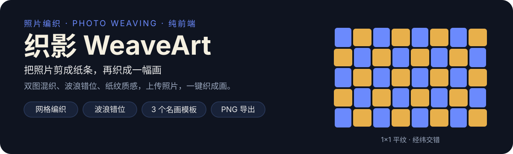
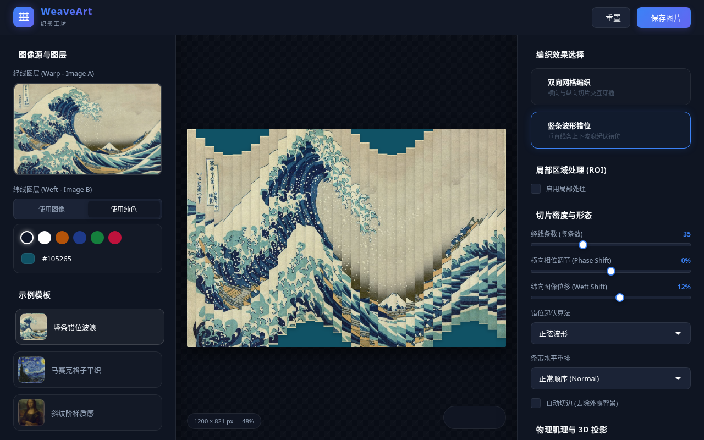
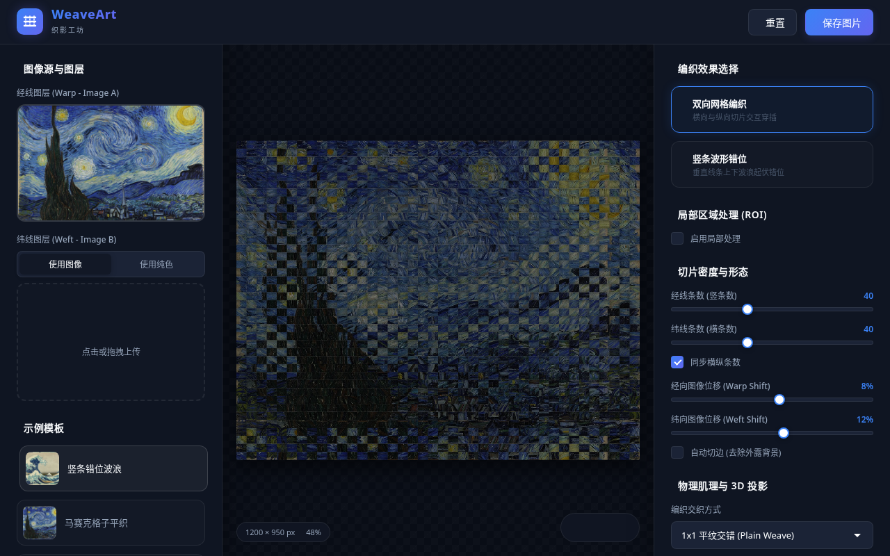

<p align="right"><a href="README.md">中文</a></p>

<p align="center">
  
</p>

<p align="center">
  <a href="https://xiaosang.cc/cut-and-remix/">▶ Try Online</a>
  ·
  <a href="https://github.com/holynova/cut_and_remix">GitHub Repository</a>
</p>

WeaveArt is a web-based photo weaving and image deconstruction studio: it slices a photo into paper strips and weaves them back into a picture. Two modes — two-way grid weaving and vertical wave shifting — support mixing two images or pairing one image with solid-color card stock, with fold shadows, cut-edge highlights and paper textures, exported as PNG.

## Screenshots

<p align="center">
  
</p>

<p align="center">
  
</p>

## Features

- **Two-way grid weaving**: interlaced warp/weft strips in 1×1 平纹 plain weave, 2×2 斜纹 twill or 3×3 斜纹 twill; warp (vertical) and weft (horizontal) strips start at 30 each by default, with independent strip counts and image shifts per direction.
- **Vertical wave shifting**: the image is sliced into equal-width vertical strips and displaced by four algorithms — 交替上下 alternating, 正弦波形 sine, 锯齿波形 triangle (sawtooth), 随机噪音 random noise — plus horizontal phase control.
- **Strip reorder**: normal order, mirrored alternate, Faro interlace, or random shuffle.
- **Two images or card stock**: the warp layer (Image A) and weft layer (Image B) each take an upload, or the weft can be solid-color card stock (6 presets + color picker).
- **Auto-crop**: exposed background at the edges is trimmed automatically after displacement.
- **Local processing (ROI)**: limit the weave/shift effect to a selected region.
- **Physical texture**: dynamic fold shadows and cut-edge highlights, plus three paper grains — 哑光特种纸 matte specialty paper, 粗糙画布纹 rough canvas, 细密亚麻布 fine linen (or none).
- **Sample templates**: three one-click public-domain masterpieces with adaptive parameters — 《神奈川冲浪里》 Hokusai's *The Great Wave off Kanagawa* (wave shift), 《星月夜》 Van Gogh's *Starry Night* (plain-weave mosaic), 《蒙娜丽莎》 Da Vinci's *Mona Lisa* (twill steps).
- **Canvas controls**: mouse wheel to zoom, left-drag to pan; export to PNG in one click.

## Run Locally

A pure static frontend, zero build, zero dependencies:

```bash
python3 -m http.server 8080
# Open http://127.0.0.1:8080
```

## Tech

- Pure HTML + CSS + JS, Canvas rendering; the weaving engine lives in `weaving-engine.js`, UI logic in `app.js`.
- Sample images are public-domain masterpieces (`assets/sample1-3.jpg`).

```
index.html          Entry: side panels + canvas workspace
app.js              UI logic: upload, templates, parameters, zoom/pan, export
weaving-engine.js   Weaving engine: grid weaving, wave shifting, reorder, crop
style.css           Dark workshop styling
assets/             3 sample masterpieces
screenshot.png      Old UI screenshot (empty state, superseded by the new shots)
```
