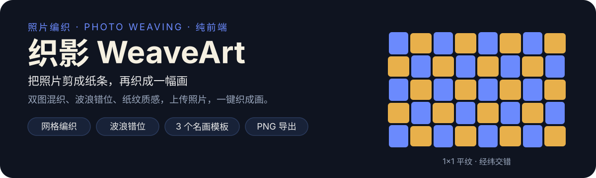
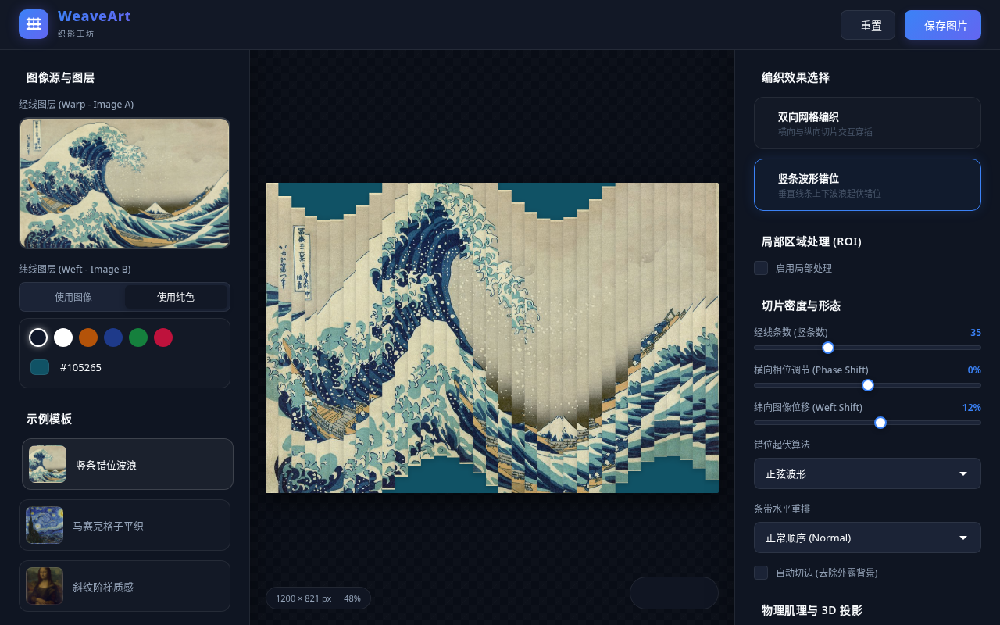
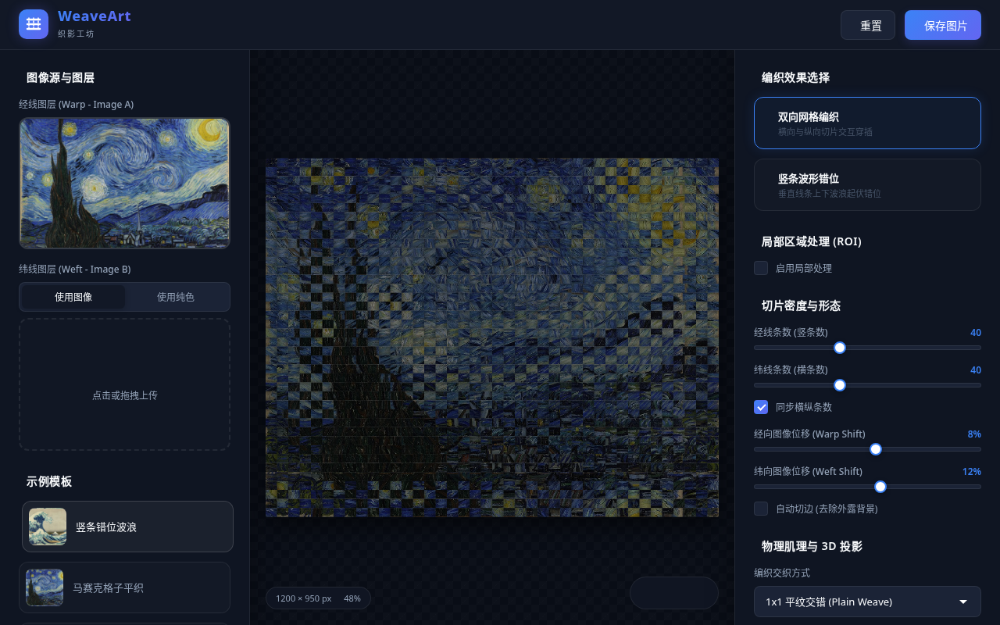

<p align="center">
  
</p>

<p align="center">
  <a href="https://xiaosang.cc/cut-and-remix/">▶ 在线体验 Play Online</a>
  ·
  <a href="https://github.com/holynova/cut_and_remix">GitHub 仓库</a>
</p>

织影 WeaveArt 是一款网页版数字化照片编织（Photo Weaving）与图像解构艺术工坊：把照片切成纸条，再按经纬交错织成一幅画。两种玩法——双向网格编织与竖条波形错位，支持双图混织或单图配纯色卡纸，叠加折叠阴影、切口高光与纸张肌理，最后导出 PNG。

WeaveArt is a web-based photo weaving and image deconstruction studio: it slices a photo into paper strips and weaves them back into a picture. Two modes — two-way grid weaving and vertical wave shifting — support mixing two images or pairing one image with solid-color card stock, with fold shadows, cut-edge highlights and paper textures, exported as PNG.

## 截图 / Screenshots

<p align="center">
  
</p>

<p align="center">
  
</p>

## 功能 / Features

- **双向网格编织**：纵横纸条交错，织法有 1×1 平纹、2×2 斜纹、3×3 斜纹；经线（竖条）与纬线（横条）各 30 条起（默认），可分别调条数与图像位移。
- **竖条波形错位**：图像切成等宽竖条，按 4 种算法上下错位——交替上下、正弦波形、锯齿波形、随机噪音；另有横向相位调节。
- **条带水平重排**：正常顺序、左右交替镜像、左右交错穿插（Faro）、随机乱序。
- **双图混织 / 纯色卡纸**：经线图层（Image A）与纬线图层（Image B）可各传一张图，或纬线用纯色卡纸（6 色预设 + 自定义取色）。
- **自动切边**：错位后自动裁掉边缘外露的背景。
- **局部处理（ROI）**：可只对选定区域做编织/错位效果。
- **拟真质感**：动态折叠阴影与切口高光，叠加 3 种纸张肌理——哑光特种纸、粗糙画布纹、细密亚麻布（也可无纹理）。
- **示例模板**：3 个一键载入的名画模板——《神奈川冲浪里》竖条错位波浪、《星月夜》马赛克格子平织、《蒙娜丽莎》斜纹阶梯质感，参数自适应。
- **画布操作**：鼠标滚轮缩放、左键拖拽平移；一键导出 PNG。

## 本地运行 / Run Locally

纯静态前端，零构建、零依赖：

```bash
python3 -m http.server 8080
# 打开 http://127.0.0.1:8080
```

## 技术 / Tech

- 纯 HTML + CSS + JS，Canvas 渲染；编织算法独立在 `weaving-engine.js`，界面逻辑在 `app.js`。
- 示例图为公有领域世界名画（`assets/sample1-3.jpg`）。

```
index.html          入口：左右面板 + 画布工作区
app.js              界面逻辑：上传、模板、参数、缩放平移、导出
weaving-engine.js   编织引擎：网格编织、波形错位、重排、切边
style.css           深色工坊风格样式
assets/             3 张示例名画
screenshot.png      旧版界面截图（空状态，已由新截图取代）
```

## English

**WeaveArt** is a web-based photo weaving and image deconstruction studio: slice a photo into strips and weave them back into a picture.

- **Grid weaving**: interlaced warp/weft strips in 1×1 plain, 2×2 twill or 3×3 twill; independent strip counts and image shifts per direction.
- **Wave shifting**: vertical strips displaced by four algorithms — alternating, sine, triangle (sawtooth) or random noise — plus phase control.
- **Strip reorder**: normal, mirrored alternate, Faro interlace, or random shuffle; auto-crop removes exposed background.
- **Two images or card stock**: warp (Image A) and weft (Image B) layers each take an upload, or weft can be solid-color card (6 presets + color picker).
- **Physical texture**: dynamic fold shadows, cut-edge highlights, and three paper grains — matte, canvas, linen (or none). ROI mode limits the effect to a selected region.
- **Templates**: three one-click public-domain masterpieces — Hokusai's *Great Wave* (wave shift), Van Gogh's *Starry Night* (plain weave), Da Vinci's *Mona Lisa* (twill) — with adaptive parameters.
- **Run it**: static site, no build — `python3 -m http.server 8080`. Export to PNG in one click.
- **Tech**: vanilla HTML + CSS + JS, Canvas rendering; the weaving engine lives in `weaving-engine.js`.
